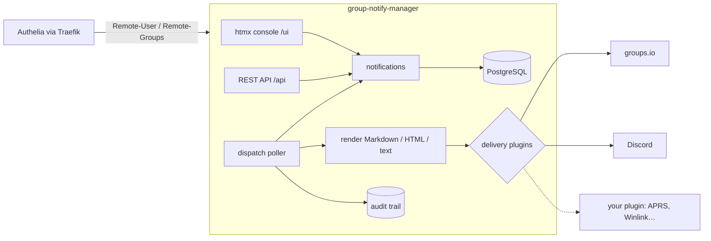

# group-notify-manager

A Kotlin / Spring Boot service that sends a group's notifications on schedule: a
monthly meeting reminder to a groups.io list, a net-night ping to a Discord channel,
a text to a handful of phones. Each notification is sent once or on a recurring
schedule, through one or more deliveries, and every send is recorded.

It follows the patterns of iot-pipeline and oiltank-monitor: one JVM serving a REST
API and an htmx console, feature packages with explicit bean wiring, PostgreSQL behind
ports, and Authelia in front.

## How it works



- **Groups come from Authelia.** A notification belongs to one OIDC group (an LLDAP
  group, passed on by Authelia). Only that group's members, and admins, see it.
- **Schedules** are one-off or recurring (cron, in the notification's own time zone,
  with an optional end date). Notifications can be paused and resumed.
- **Bodies** are written in Markdown or a WYSIWYG editor; each delivery gets the form
  it suits: sanitised HTML for groups.io, Markdown for Discord, plain text for
  plugins that need it.
  Placeholders such as `{{date}}` are filled in when it is sent.
- **Deliveries are plugins, set up per group.** groups.io and Discord are bundled; a
  new one is a jar implementing a small, dependency-free interface, dropped into
  `plugins-dir/`. An admin provisions a plugin for a group as a named instance, holding
  its credentials (encrypted at rest) and defaults; a notification picks its group's
  instances and may change only how they post.
- **The audit trail** records every change and every delivery, with its outcome.

## Status

Working end to end: the console, the REST API, scheduling, the two bundled
plugins, external plugins, the audit trail, and both Authelia modes. Not yet
exercised against real Discord or groups.io accounts, nor the PostgreSQL
stores against a live database (their tests need Docker).

## Requirements

- JDK 21 (the Gradle toolchain will find one if it is not your default)
- Docker with Compose, for PostgreSQL and Mailpit

## Quick start

```bash
./scripts/bootstrap.sh                 # passwords into .env
docker compose up -d                   # PostgreSQL on 5433, Mailpit on 1025/8025
cp src/main/resources/application-local.example.yml src/main/resources/application-local.yml
./gradlew bootRun                      # http://localhost:5002
```

The example local settings sign every request in as a development user in
`homelab_admins`, `notify_club` and `notify_family`, since there is no Authelia on a
workstation. Create a notification, add a **Log only** delivery, and Send now.

To run without PostgreSQL: `NOTIFICATION_STORE=memory AUDIT_STORE=memory ./gradlew bootRun`.

## Documentation

See [docs/README.md](docs/README.md): the console, writing plugins, security and
Authelia, configuration, operations, development, and the design.

## License

MIT; see [LICENSE](LICENSE).
